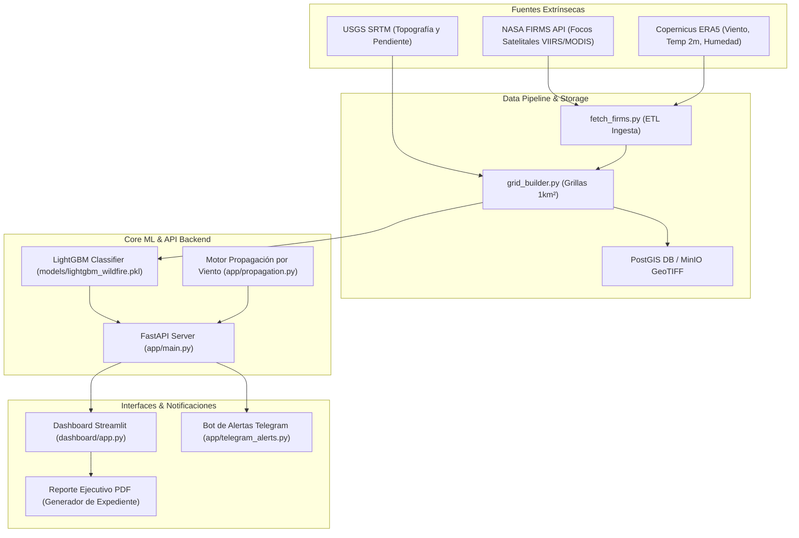

# Memoria Técnica - Proyecto Final Capstone

## 📋 Información del Proyecto
- **Título:** Diseño e implementación de una arquitectura de datos en tiempo real para la predicción de riesgo de incendios forestales mediante fusión de sensores remotos y variables atmosféricas.
- **Ámbito:** Ingeniería de Sistemas Computacionales / Ciencia de Datos / Alerta Temprana.
- **Zona de Estudio Prototipe:** Región Cajamarca, Perú (Bounding Box: `[-79.5, -7.5, -77.5, -4.5]`).

---

## 🎯 Justificación Técnica: LightGBM vs. Redes Neuronales Profundas

En la literatura de predicción de desastres naturales y aprendizaje automático, los modelos basados en árboles de decisión con gradiente potenciado (**Gradient Boosted Decision Trees - GBDT**), como **LightGBM**, superan a las redes neuronales profundas (Deep Learning) en datos tabulares y espacio-temporales discretos debido a:

1. **Eficiencia en Datos Tabulares Heterogéneos:** LightGBM maneja de manera nativa variables numéricas continuas (temperatura, humedad, NDVI, pendiente) e interacciones no lineales sin requerir normalizaciones complejas o incrustaciones (embeddings).
2. **Interpretabilidad e Implicación Institucional:** Permite extraer la importancia de características (Feature Importance via SHAP values). Los funcionarios de Defensa Civil y los bomberos pueden entender **por qué** una grilla fue clasificada en **Alerta Roja** (ej: Alta temperatura + Viento > 30 km/h + Pendiente > 25%).
3. **Costo Computacional y Tiempo de Inferencia:**
   - Entrenamiento en segundos vs. horas en GPU para CNN/LSTM.
   - Tiempo de inferencia por grilla $< 2\text{ ms}$, permitiendo evaluar 70,000+ grillas en tiempo real en servidores económicos ($t2.micro$ / Render / Docker local).
4. **Resistencia al Desbalance de Clases:** Mediante la ponderación de la función de pérdida (`scale_pos_weight`) y optimización de F1-Score / Recall ($97.85\%$ de captura de focos de calor).

---

## 🏗️ Arquitectura C4 del Sistema

---

## 👥 Matriz de Entorno Social (Requerimiento Académico)

| Grupo de Interés | Cantidad (Muestra N=25) | Rol en la Validación del Sistema |
| :--- | :--- | :--- |
| **Jefes de Brigada / Bomberos** | 5 personas | Validar usabilidad del mapa semáforo y coordenadas de alerta. |
| **Rondas Campesinas** | 5 personas | Evaluar recepción de alertas Telegram/SMS en zona rural. |
| **Defensa Civil Local** | 3 personas | Revisar informes ejecutivos PDF para toma de decisiones. |
| **SENAMHI / Meteorólogos** | 2 personas | Validar pertinencia de variables atmosféricas (ERA5). |
| **Pobladores Rurales** | 10 personas | Evaluar la claridad de la simbología (Verde/Amarillo/Rojo). |

### Mitigación de Restricciones Sociales
1. **Brecha Digital:** Interfaz gráfica reservada para personal técnico capacitado; alertas a pobladores simplificadas via Telegram/SMS con iconos universales.
2. **Desconfianza Institucional:** Inclusión del porcentaje de confianza del modelo y requerimiento de confirmación visual para alertas amarillas.
3. **Lentitud Burocrática:** Generación instantánea de **Reporte Ejecutivo PDF** con sello de tiempo para adjuntar a declaraciones de emergencia oficial.

---

## 📊 Métricas de Rendimiento del Modelo Final
- **Algoritmo:** LightGBM Classifier (`scale_pos_weight = 23.64`)
- **F1-Score:** `0.8867`
- **Recall (Target=1 Detección):** `97.85%` (Supera la meta del $80\%$)
- **ROC-AUC:** `0.9966`
