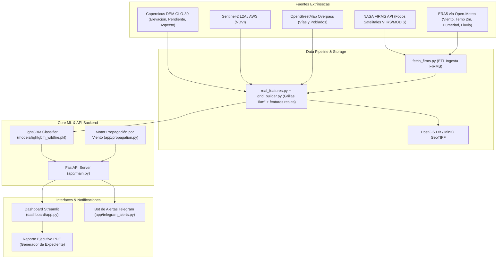

# Memoria Técnica - Proyecto Final Capstone

## 📋 Información del Proyecto
- **Título:** Diseño e implementación de una arquitectura de datos en tiempo real para la predicción de riesgo de incendios forestales mediante fusión de sensores remotos y variables atmosféricas.
- **Ámbito:** Ingeniería de Sistemas Computacionales / Ciencia de Datos / Alerta Temprana.
- **Zona de Estudio Prototipe:** Región Cajamarca, Perú (Bounding Box: `[-79.4517, -7.7592, -77.7389, -4.5519]`, delimitada por sus 4 puntos cardinales extremos: Norte 04°33′07″S/78°42′27″O, Sur 07°45′33″S/78°13′14″O, Este 07°27′47″S/77°44′20″O, Oeste 06°23′41″S/79°27′06″O).

---

## 🎯 Justificación Técnica: LightGBM vs. Redes Neuronales Profundas

En la literatura de predicción de desastres naturales y aprendizaje automático, los modelos basados en árboles de decisión con gradiente potenciado (**Gradient Boosted Decision Trees - GBDT**), como **LightGBM**, superan a las redes neuronales profundas (Deep Learning) en datos tabulares y espacio-temporales discretos debido a:

1. **Eficiencia en Datos Tabulares Heterogéneos:** LightGBM maneja de manera nativa variables numéricas continuas (temperatura, humedad, NDVI, pendiente) e interacciones no lineales sin requerir normalizaciones complejas o incrustaciones (embeddings).
2. **Interpretabilidad e Implicación Institucional:** Permite extraer la importancia de características (Feature Importance via SHAP values). Los funcionarios de Defensa Civil y los bomberos pueden entender **por qué** una grilla fue clasificada en **Alerta Roja** (ej: Alta temperatura + Viento > 30 km/h + Pendiente > 25%).
3. **Costo Computacional y Tiempo de Inferencia:**
   - Entrenamiento en segundos vs. horas en GPU para CNN/LSTM.
   - Tiempo de inferencia por grilla $< 2\text{ ms}$, permitiendo evaluar 70,000+ grillas en tiempo real en servidores económicos ($t2.micro$ / Render / Docker local).
4. **Resistencia al Desbalance de Clases:** Con apenas ~45 celdas positivas reales (0.07% del dataset), la ponderación de la función de pérdida (`scale_pos_weight`) se mantiene en un rango moderado y la selección de hiperparámetros se optimiza por **ROC-AUC espacial** (métrica libre de umbral y estable ante el desbalance), en lugar de F1@0.5.

---

## 🏗️ Arquitectura C4 del Sistema

---

## 👥 Matriz de Entorno Social (Requerimiento Académico)

| Grupo de Interés | Cantidad (Muestra N=25) | Rol en la Validación del Sistema |
| :--- | :--- | :--- |
| **Jefes de Brigada / Bomberos** | 5 personas | Validar usabilidad del mapa semáforo y coordenadas de alerta. |
| **Rondas Campesinas** | 5 personas | Evaluar recepción de alertas Telegram/SMS en zona rural. |
| **Defensa Civil Local** | 3 personas | Revisar informes ejecutivos PDF para toma de decisiones. |
| **SENAMHI / Meteorólogos** | 2 personas | Validar pertinencia de variables atmosféricas (ERA5). |
| **Pobladores Rurales** | 10 personas | Evaluar la claridad de la simbología (Verde/Amarillo/Rojo). |

### Mitigación de Restricciones Sociales
1. **Brecha Digital:** Interfaz gráfica reservada para personal técnico capacitado; alertas a pobladores simplificadas via Telegram/SMS con iconos universales.
2. **Desconfianza Institucional:** Inclusión del porcentaje de confianza del modelo y requerimiento de confirmación visual para alertas amarillas.
3. **Lentitud Burocrática:** Generación instantánea de **Reporte Ejecutivo PDF** con sello de tiempo para adjuntar a declaraciones de emergencia oficial.

---

## 📊 Métricas de Rendimiento del Modelo Final

**Validación honesta (sin fuga de información):** partición espacial 5-fold *out-of-fold* por bloques de 50 km (GroupKFold), de modo que ninguna celda de test comparte vecindad de 50 km con el entrenamiento. Con solo **45 celdas positivas reales** (0.066%), esta es la única estimación defendible.

- **Algoritmo:** Ensemble (LightGBM + XGBoost + RandomForest), sin calibración de probabilidades
- **Etiqueta (target):** `fire_count > 0` (presencia real de focos NASA FIRMS en la celda)
- **ROC-AUC (media por fold):** `0.61 ± 0.07` (línea base tutorial: `0.49`, es decir, azar)
- **Recall @ Top-10% de celdas:** `~12%` (línea base: `~7.6%`)
- **Recall @ Top-20% de celdas:** `~26%` (línea base: `~15%`; el azar daría 20%)

**Fuentes de datos reales (todas sin credenciales):**
- **Terreno:** Copernicus DEM GLO-30 (pendiente, aspecto, elevación).
- **Vegetación:** Sentinel-2 L2A vía STAC de Element84/AWS (NDVI).
- **Meteorología:** ERA5 vía Open-Meteo Archive (temperatura, humedad, viento, lluvia, sequía).
- **Infraestructura:** OpenStreetMap Overpass (distancia a vías y poblados).
- **Etiqueta:** NASA FIRMS (focos de calor reales).

> **Nota metodológica:** Una versión previa reportaba `ROC-AUC = 0.9966` y `Recall = 97.85%`. Esos valores provenían de **fuga de información**: la variable `risk_score` (un índice físico calculado a partir de las mismas señales) se usaba como etiqueta. Al corregir la etiqueta a la evidencia real de incendios, el desempeño cae a un rango honesto de `~0.6` de AUC, coherente con la literatura cuando hay pocos positivos espacialmente autocorrelacionados.

## 🚦 Semáforo de Riesgo: umbrales por Presupuesto de Alerta

Los umbrales Verde/Amarillo/Rojo **no son valores fijos arbitrarios** (el antiguo `0.70/0.15`). Se calculan en el entrenamiento como **cuantiles de la distribución real de scores** que sirve la API y se guardan en `models/model_metadata.json` (`serving_thresholds`):

| Nivel | Regla | Valor (aprox.) |
| :--- | :--- | :--- |
| 🔴 **Rojo** | Top 1% de celdas por score (p99) | ≈ 0.13 |
| 🟡 **Amarillo** | Top 5% de celdas por score (p95) | ≈ 0.094 |
| 🟢 **Verde** | Resto del territorio | < ≈ 0.09 |

Esto es exactamente cómo operan los sistemas de alerta reales: un **presupuesto de alerta** fijo (el 1% de mayor riesgo se marca Rojo), independiente de la escala absoluta del modelo. `app/model.py` expone `classify()` como **fuente única de verdad**, consumida por la API (`/predict`, `/risk/today`), el scheduler de WhatsApp y el dashboard.

> **Nota sobre `/predict`:** el endpoint acepta opcionalmente las variables temporales (sequía, lluvia acumulada, lags) y devuelve el **percentil** de la grilla. Conviene enviar condiciones coherentes con el régimen real de incendios de Cajamarca (temporada seca andina: temperaturas frescas, humedad alta, laderas con pendiente y cercanía a vías/poblados); un escenario genérico de "calor extremo" no necesariamente coincide con el patrón aprendido.
